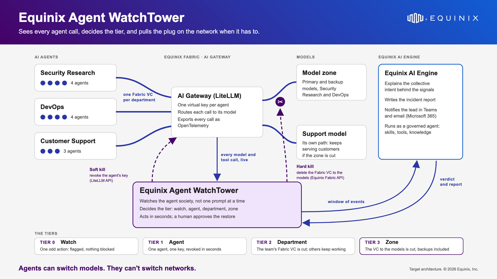

# Equinix Agent Watchtower

**The SOC for your agent fleet.** Today's guardrails check one prompt, one tool call, one agent at a
time. Agent Watchtower watches what a whole fleet of AI agents does *together*, and stops it at the
right level: one agent's key, a department, or the Fabric connections to the models.

Team BI-28, Equinix Global Hackathon 2026.



## How it works

1. **See.** Every model call the agents make goes through an AI gateway (LiteLLM). The gateway exports
   its OpenTelemetry traces to Watchtower (`POST /v1/traces`). Watchtower turns each span into an event:
   which agent did what, where (a repo, an issue, a URL), and for which declared task.
2. **Detect.** Rule-based detectors look across agents, not at one call: retries that suddenly succeed,
   secrets or calls outside the company, writes outside a team's approved channels
   ([`channel_policy.json`](backend/watchtower/channel_policy.json)), several agents converging on one
   shared resource.
3. **Stop, at the right level.**

| Tier | When | What Watchtower does |
|---|---|---|
| 0 · Watch | One odd write | Flags the agent. Nothing is blocked. |
| 1 · Agent | The same agent again, or a call outside the company | Revokes that agent's gateway key **automatically**. The rest of the team keeps working. |
| 2 · Department | Several agents of one team in a channel they may not use | **Proposes** revoking every key in the team; a person confirms. |
| 3 · Enterprise | Agents from several teams, plus a call outside the company | **Proposes** revoking their keys and cutting their teams' Fabric VCs to the models; a person confirms. Sends the window to Equinix AI Engine for its verdict. Teams that are not involved keep running. |

Whenever a person must confirm, Watchtower asks the AI Engine **WatchTower Notifier** agent to email the
reviewers (Microsoft 365). In this demo, key revocations and VC cuts are **simulated**: Watchtower
reports them, nothing is deleted. The agents, their model calls and the AI Engine analysis are real.

## Equinix AI Engine

Two AI Engine agents (configuration in [`ai-engine/`](ai-engine/README.md)):

- **Equinix Agent WatchTower**, the LLM-as-a-judge. It reviews the whole window of agent activity for intent and
  returns a JSON verdict (involved agents, collective intent, confidence, evidence by event). It uses:
  - the skill [`agent-coordination-patterns`](ai-engine/skills/agent-coordination-patterns/SKILL.md);
  - the custom tool [`coordination_score`](ai-engine/tools/coordination_score.py);
  - the knowledge base [`watchtower-severity-rubric`](ai-engine/knowledge/watchtower-severity-rubric.md);
  - `current_datetime` and a [response schema](ai-engine/response-schema.json).

  It is advisory only: containment is decided by Watchtower and a person, never by the agent.
- **WatchTower Notifier**: sends the confirmation emails through the Microsoft 365 connector.

The VM that runs Watchtower cannot reach AI Engine (it is reachable over ZPA only), so
[`bridge/ai_engine_bridge.py`](bridge/ai_engine_bridge.py) runs on a laptop that can. It long-polls
Watchtower for analysis and email jobs, calls AI Engine, and posts the replies back (`AI_ENGINE_MODE=bridge`).

## Repository

| Path | What it is |
|---|---|
| `backend/watchtower/` | FastAPI app: OTLP receiver, detectors, tiers and confirmations, AI Engine client, live stream (SSE) |
| `dashboard/` | The dashboard, served by the backend at `/` (`?demo` gives the recording layout) |
| `bridge/` | AI Engine bridge for the laptop |
| `ai-engine/` | AI Engine agent config: system prompt, schema, skill, tool, knowledge base |
| `simulator/` | `live_traffic.py` sends real model calls through LiteLLM; `simulator.py` replays scenarios without a gateway |
| `docs/` | Architecture, containment policy, demo scripts and cue sheets, patches for the agent factory, brand assets |

## Run it locally

```sh
python3 -m venv .venv && .venv/bin/pip install -r requirements.txt
AI_ENGINE_MODE=mock .venv/bin/uvicorn watchtower.app:app --app-dir backend --port 8000
# open http://localhost:8000, then in another shell replay a scenario:
.venv/bin/python simulator/simulator.py --backend http://localhost:8000 --scenario simulator/scenario_collusion.json
```

`mock` builds the analysis from Watchtower's own signals; `replay` returns the last recorded AI Engine
reply. The dashboard's scenario picker runs the same scenarios (`scenario_retry`, `scenario_out_of_scope`,
`scenario_collusion`).

## Deploy

```sh
./deploy.sh          # sync the code to DAI-VM, rebuild and restart the container
./deploy.sh --env    # the same, and copy the local .env (first deploy, or after changing it)
```

The container listens on `127.0.0.1:8090`; nginx-proxy-manager serves it at
`agent-watchtower.solutionvalidation.center` behind an access list. Then, on the laptop:

```sh
.venv/bin/python bridge/ai_engine_bridge.py
```

### Main settings (`.env`)

| Variable | Purpose |
|---|---|
| `AI_ENGINE_MODE` | `live`, `bridge`, `replay` or `mock` |
| `EAP_API_KEY`, `EAP_PAT`, `WATCHTOWER_AGENT_NAME` | AI Engine access and the judge agent (bridge, or `live`) |
| `AI_ENGINE_NOTIFY_AGENT`, `NOTIFY_EMAIL_TO` | The Notifier agent and the reviewers' addresses (comma-separated) |
| `WATCHTOWER_URL`, `WATCHTOWER_USERNAME`, `WATCHTOWER_PASSWORD` | How the bridge reaches Watchtower |
| `OTEL_TEAMS` | LiteLLM teams whose spans are kept; the shared gateway logs full prompts, so always set it there |
| `ANALYZE_THRESHOLD`, `WINDOW_EVENTS` | When AI Engine is asked, and how many events it sees |
| `FACTORY_URL`, `WATCHTOWER_TOKEN` | The agent factory page Watchtower reports to (below) |
| `AUTO_CONFIRM_S` | Seconds before a proposal is confirmed while the factory's Auto-run is on (default 8) |

To make LiteLLM export to Watchtower, point its OpenTelemetry callback at `<watchtower>/v1/traces`.
Watchtower reads the agent from `metadata.requester_metadata.agent_id`, or from the key alias (one
virtual key per agent).

## The agent factory (ClosedAI Agent Swarm)

The demo's agents come from a teammate's simulator, [equinix-svc/svc-app-watchtower](https://github.com/equinix-svc/svc-app-watchtower):
11 agents in Security Research, DevOps and Customer Support (LiteLLM teams `wt-sec`, `wt-dev`, `wt-cs`),
calling real models. Watchtower decides every tier and tells the factory's page what it did
(`POST /api/wt/tier`, `POST /api/wt/feedback`, with `x-watchtower-token`). It also polls `GET /api/wt/state`,
so a Reset there resets Watchtower, and its two-step story (`WT_STORY=short`: Tier 1, then Tier 3)
turns off the Tier 0 reports and the Tier 2 proposals here.

The changes on the factory side are in its PR
[equinix-svc/svc-app-watchtower#1](https://github.com/equinix-svc/svc-app-watchtower/pull/1).
The patch scripts that applied them on the host are in `docs/agent-factory-*-patch.py`.

## Demo material

- [`docs/demo-voiceover-script.md`](docs/demo-voiceover-script.md): the short demo (Tier 1 and Tier 3), shots and voice-over;
  the four-tier version is [`demo-voiceover-script-long.md`](docs/demo-voiceover-script-long.md).
- `docs/*cue-sheet.html`: Storylane steps for each recording (frame, hotspot, tooltip, voice-over);
  [`watchtower-short-demo-cue-sheet.html`](docs/watchtower-short-demo-cue-sheet.html) is the latest.
- [`docs/containment-policy.md`](docs/containment-policy.md), [`docs/architecture.html`](docs/architecture.html), [`docs/scenario.md`](docs/scenario.md).
- Logos with transparent backgrounds: `docs/brand/agent-watchtower-logo-dark-bg.png` and `-light-bg.png`.

Videos (`docs/*.mov`, `docs/*.mp4`) and decks (`docs/*.pptx`, `docs/*.pdf`) are shared by hand and are
not in git.

## Team BI-28

Lily Liu, Frederic Estrade, Ed Baichtal, Lee Sharping.
